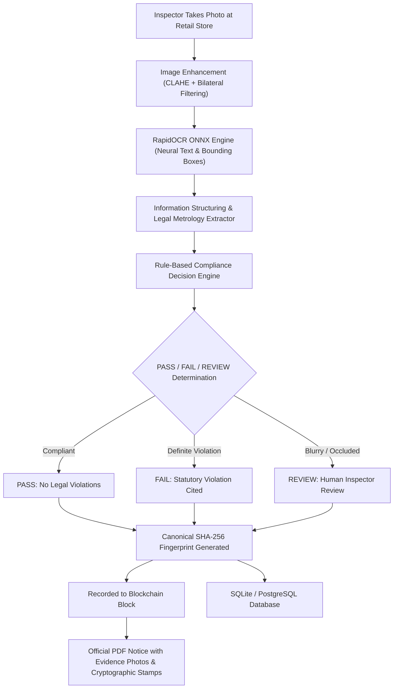

# SmartMetrology: AI-Powered Legal Metrology Compliance Inspection & Tamper-Evident Ledger

> **One-Line Project Explanation:**
> **SmartMetrology** is an automated compliance inspection platform that reads statutory declarations from packaged commodity images using computer vision and deep learning OCR, validates them against the **Legal Metrology (Packaged Commodities) Rules, 2011**, flags infractions with statutory citations, generates official inspection reports, and records SHA-256 digital evidence fingerprints onto an immutable blockchain ledger to prevent record tampering.

---

## 1. Problem Addressed

Packaged commodities in India are legally mandated under the **Legal Metrology Act, 2009** and **Legal Metrology (Packaged Commodities) Rules, 2011** to prominently display mandatory declarations:
- Maximum Retail Price (MRP) inclusive of all taxes
- Net Quantity in standard metric units (`g`, `kg`, `ml`, `l`, `m`, etc.)
- Month & Year of manufacture / packing / import
- Complete Name & Address of manufacturer, packer, or importer
- Consumer Care contact details (helpline telephone, email, and address)
- Generic or common name of the commodity
- Country of origin

### Challenges of Manual Inspection:
- **Time-Consuming & Fatigue-Prone:** Physical inspection of thousands of SKUs in retail stores is slow.
- **Human Error:** Small font sizes, curved surfaces, and reflective packaging make it difficult to catch subtle violations (e.g., illegal units like `gms` instead of `g`, or missing tax inclusion text).
- **Inconsistent Record-Keeping:** Manual paperwork lacks cryptographic chain of custody, making inspection evidence susceptible to alteration or dispute in court.

---

## 2. Core Architecture & Workflow



> [!IMPORTANT]
> **Crucial Conceptual Distinction:**
> - **AI / OCR** *extracts and structures* the label information from the packaging photo.
> - The **Rule Engine** performs the *actual legal compliance checks* based on statutory provisions.
> - **Database** stores *detailed inspection data, images, and reports*.
> - **Blockchain** stores the *immutable SHA-256 hash / digital fingerprint* for tamper evidence.

---

## 3. Statutory Compliance Rules Implemented

| Statutory Rule | Requirement | Verification Logic | Outcome if Violated |
| :--- | :--- | :--- | :--- |
| **Rule 6(1)(e)** | Maximum Retail Price (MRP) | Must be present in Indian currency (`₹` / `Rs.`) and explicitly specify *"inclusive of all taxes"*. | **FAIL** |
| **Rule 6(1)(b) & Rule 13** | Net Quantity & Metric Units | Must declare net quantity in standard metric units (`g`, `kg`, `ml`, `l`, etc.). Prohibits non-standard symbols like `gm`, `gms`, `kilo`, `kilos`. | **FAIL** (Rule 13 violation) |
| **Rule 6(1)(c)** | Manufacturer / Packer Identity | Complete name and address of the manufacturing, packaging, or importing entity. | **FAIL** |
| **Rule 6(1)(d)** | Date of Manufacture / Pre-packing | Month and year of packing / manufacture (e.g., `08/2026`). | **FAIL** |
| **Rule 6(1)(a)** | Generic Commodity Title | Generic or common name of commodity isolated from brand logos. | **REVIEW / FAIL** |
| **Rule 6(1)(n)** | Consumer Grievance Cell | Telephone helpline number, email, or address for consumer complaints. | **REVIEW** |
| **Section 36(1)** | Anti-Overpricing Check | If inspector enters actual selling price charged by retailer, checks: `Selling Price > Printed MRP`. | **FAIL** (Overcharging offense) |
| **Quality Check** | Visual Clarity & OCR Confidence | Laplcian blur variance `< 80` or OCR confidence `< 60%`. | **REVIEW** (Prevents false legal accusations) |

---

## 4. The 3 Verdict Outcomes (Explainable AI)

1. **`PASS`**: No compliance violation detected. All mandatory statutory declarations are present, formatted correctly, and clearly legible.
2. **`FAIL`**: Definite rule infraction detected (e.g., MRP missing, illegal unit `gms` used, selling price above MRP, or manufacturer missing). The system provides the exact rule citation and legal rationale.
3. **`REVIEW`**: The image is blurred, packaging is curved, or OCR confidence is below the legal threshold. In accordance with legal principles, the system refuses to blindly make an unverified decision and routes the case to human inspector verification.

---

## 5. Blockchain Tamper-Evidence Layer

- **Process:**
  `Inspection Record` $\rightarrow$ `Canonical JSON` $\rightarrow$ `SHA-256 Digest` $\rightarrow$ `Blockchain Block`
- **Tamper Detection Demonstration:**
  If an unauthorized party alters the database after an inspection (e.g., changing recorded MRP from `₹50` to `₹35`), the system recalculates the canonical SHA-256 hash.
  $$\text{Blockchain Block Hash} \neq \text{Recalculated Database Hash} \implies \text{CRITICAL TAMPER ALERT}$$
- **Interactive Lab:** The system includes an evaluator **"Simulate Tampering"** button to demonstrate live how the blockchain catches unauthorized database edits!

---

## 6. Counterfeit Prevention Extension (Sections 14–15)

- **Important Limitation:** An image-based AI alone cannot prove a physical copy is genuine if a counterfeiter manufactures an identical label with identical barcode/MRP.
- **Our Solution:** The system introduces serialized unit identities:
  1. Manufacturer registers a batch and generates serialized unit IDs (`ABC001`, `ABC002`, ...).
  2. Inspector scans unit ID at a retail store.
  3. **Duplicate Clone Detection:** If the same unique unit ID is scanned at *Shop 1* and later appears at *Shop 2*, the system flags an immediate **"Duplicate Serial Clone Alert"** indicating counterfeit replication.

---

## 7. Pre-Bundled Test Scenarios (1-Click Demo)

The system includes 5 pre-rendered packaging labels for instant evaluation:
1. **Compliant Butter Cookies:** All 7 declarations present, metric unit `500 g`, tax declaration present $\rightarrow$ **PASS**
2. **Ayurvedic Night Cream:** MRP completely omitted $\rightarrow$ **FAIL (Rule 6(1)(e))**
3. **Sharbati Wheat Flour:** Uses prohibited non-standard unit `5 gms` instead of `5 g` $\rightarrow$ **FAIL (Rule 6(1)(b) & Rule 13)**
4. **Surf Detergent Pouch:** Simulated blur and low contrast $\rightarrow$ **REVIEW (Visual Clarity / Human-in-the-loop)**
5. **Refined Sunflower Oil:** Printed MRP ₹140, shopkeeper selling price ₹180 $\rightarrow$ **FAIL (Section 36(1) Overcharging)**

---

## 8. How to Run the Project

### Prerequisites
- Python 3.10+ (Tested on Python 3.13)
- Node.js 18+ & npm

### Quick Start (Windows)
Double-click `start.bat` or run in PowerShell:
```powershell
.\run.ps1
```

### Manual Start

#### 1. Backend (FastAPI)
```powershell
# Activate virtual environment
.\venv\Scripts\activate

# Launch FastAPI server
python -m uvicorn backend.app.main:app --host 127.0.0.1 --port 8000 --reload
```
- API Base URL: `http://127.0.0.1:8000`
- Interactive Swagger Docs: `http://127.0.0.1:8000/docs`

#### 2. Frontend (React + Vite + Tailwind CSS)
```powershell
cd frontend
npm run dev
```
- Web Application: `http://localhost:5173`

---

## 9. Running Automated Test Suites

```powershell
# Run core CV, OCR, and rule engine pipeline tests
.\venv\Scripts\python tests\test_pipeline.py

# Run complete end-to-end API integration test suite
.\venv\Scripts\python tests\test_api.py
```

---

## 10. Key Points for Hackathon / Viva Presentations

| What to SAY | What NOT to say |
| :--- | :--- |
| **"AI and OCR extract and structure information from the label."** | ❌ *"AI checks the law."* |
| **"A rule-based engine performs legal compliance verification based on statutory rules."** | ❌ *"The neural network decides if a product is illegal."* |
| **"Uncertain or blurred packages trigger REVIEW for human verification."** | ❌ *"The AI has 100% accuracy and replaces inspectors."* |
| **"SHA-256 and blockchain make inspection records tamper-evident."** | ❌ *"Blockchain detects fake products."* |
| **"Database stores detailed records; blockchain stores cryptographic proof hashes."** | ❌ *"Blockchain replaces our database."* |
| **"Overpricing detection compares printed MRP with inspector-entered shop prices."** | ❌ *"An image alone can detect overcharging."* |
